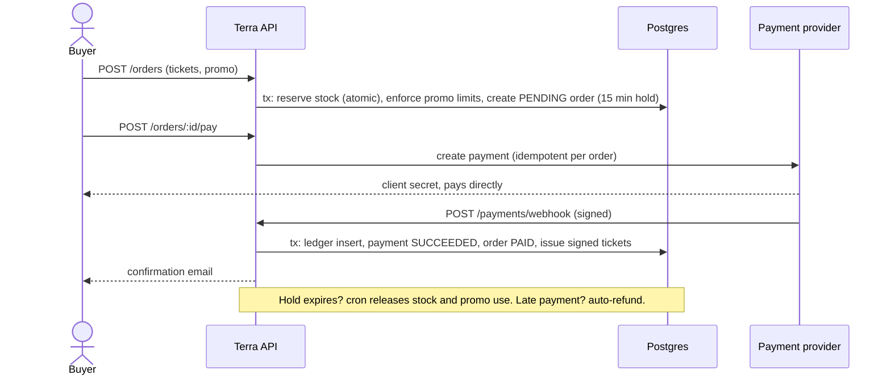

# Terra

An event-ticketing platform API: organizers publish events and sell tickets, attendees buy them
(with promo codes), pay, receive signed QR tickets, and get scanned in at the door. Built with
**NestJS 10**, **Prisma 7**, **PostgreSQL**, in a domain-driven layout.

The interesting parts are the ones that are easy to get subtly wrong:

- **No overselling.** Stock is reserved with a single atomic `UPDATE … WHERE sold + n <= quantity`, backed by a DB `CHECK` constraint. Proven by a test that fires 12 simultaneous buyers at 5 tickets.
- **Idempotent payments.** Webhooks are signature-verified, deduplicated through a ledger table in the *same transaction* that marks the order paid and issues tickets, and rejected if the amount doesn't match.
- **Late payments are handled.** If a payment lands after the order expired or was cancelled, it's auto-refunded instead of leaving a customer charged with no ticket.
- **Unforgeable tickets.** Ticket codes are `id.HMAC(secret, id)`; check-in is a compare-and-set, so ten simultaneous scans admit exactly one.
- **Money is integers** in minor units (cents/kobo). No floats anywhere near a price.

## Quick start

Requires Node 22+ and Docker.

```bash
cp .env.example .env            # defaults work for local dev
docker compose up -d db mailpit # Postgres + a local SMTP inbox (http://localhost:8025)
npm ci
npx prisma generate        # creates the typed DB client (not part of npm ci)
npx prisma migrate deploy
npm run seed                    # demo users, events, promos and paid orders
npm run start:dev               # http://localhost:3000, Swagger at /api
```

Or run everything, API included, in containers: `docker compose up --build`.

Port already taken? Override with `POSTGRES_PORT`, `API_PORT`, `MAILPIT_SMTP_PORT`, `MAILPIT_UI_PORT`
(and point `DATABASE_URL` at the new Postgres port).

Seeded logins (password `Demo!Passw0rd#1`): `admin@terra.demo`, `organizer@terra.demo`, `attendee@terra.demo`.

### Try the purchase flow

No payment account needed. The default `fake` gateway has the same webhook shape as a real provider,
and a dev-only endpoint confirms payment through the real webhook handler.

```bash
B=http://localhost:3000/api/v1
curl -s -c jar -X POST $B/auth/login -H 'content-type: application/json' \
  -d '{"email":"attendee@terra.demo","password":"Demo!Passw0rd#1"}'
curl -s -b jar $B/events                                   # pick an event
curl -s -b jar $B/tickets/event/<EVENT_ID>                 # pick a ticket
curl -s -b jar -X POST $B/orders -H 'content-type: application/json' \
  -d '{"items":[{"ticketId":"<TICKET_ID>","quantity":2}],"promoCode":"WELCOME10"}'
curl -s -b jar -X POST $B/orders/<ORDER_ID>/pay/simulate   # dev only: "provider" confirms
curl -s -b jar $B/orders/<ORDER_ID>/tickets                # signed ticket codes
curl -s -b jar $B/issued-tickets/<TICKET_ID>/qr -o ticket.png
```

## Architecture

```
src/
  domain/          entities, repository & gateway interfaces, pure logic (ticket codes)
  application/     use cases and DTOs: the business rules, no HTTP or SQL
  infrastructure/  Nest modules, controllers, Prisma repositories, Stripe/SMTP adapters
```

Dependencies point inward. Payments and mail sit behind ports (`IPaymentGateway`, `IMailer`), so
Stripe, the fake gateway, SMTP and the log mailer are interchangeable by config.



## Configuration

See [`.env.example`](.env.example). The ones that matter:

| Variable | Purpose |
|---|---|
| `DATABASE_URL` | Postgres connection string |
| `JWT_SECRET` | Signs access tokens (required, no fallback) |
| `TICKET_SIGNING_SECRET` | Signs ticket QR codes (required). `openssl rand -hex 32` |
| `PAYMENT_PROVIDER` | `fake` (default) or `stripe` (+ `STRIPE_SECRET_KEY`, `STRIPE_WEBHOOK_SECRET`) |
| `MAIL_PROVIDER` | `log` (default) or `smtp` (+ `SMTP_*`) |
| `DEFAULT_CURRENCY`, `ORDER_HOLD_MINUTES` | Order currency (single currency per deployment) and unpaid-order hold |
| `THROTTLE_LIMIT`, `STRICT_THROTTLE_LIMIT` | Requests/min per IP; strict tier covers login, register, password flows, checkout |
| `REDIS_URL` | Optional: shared rate limits, caches, sold-out gate, durable job queue (AOF + `noeviction`) |
| `JOB_ATTEMPTS`, `JOB_BACKOFF_MS`, `JOB_CONCURRENCY` | Retry policy and worker concurrency for the job queue |
| `METRICS_TOKEN` | Optional bearer token for `/metrics` |
| `DB_POOL_MAX`, `LOG_REQUESTS` | Per-instance DB pool size; per-request access log on/off |
| `GOOGLE_*`, `FACEBOOK_*` | Optional SSO; routes return 404 when unset |
| `FRONTEND_URL`, `CORS_ORIGIN`, `TRUST_PROXY` | Email links, CORS, client-IP handling behind a proxy |

## API

Base path `/api/v1`; interactive docs at `/api` (non-production). Auth is cookie-based
(`access_token`, `refresh_token`, httpOnly) with `Authorization: Bearer` also accepted.

| Area | Endpoints |
|---|---|
| Auth | `POST /auth/register · login · refresh · logout · verify-email · resend-verification · forgot-password · reset-password`, `GET /auth/me`, Google `GET /auth/google`, Facebook `POST /auth/facebook` |
| Users | `GET/PATCH /users/me` |
| Events | `POST/GET /events`, `GET /events/my-events`, `GET/PUT/DELETE /events/:id`, `POST /events/:id/publish · cancel` |
| Tickets | `POST/GET /tickets`, `GET /tickets/event/:eventId`, `GET/PUT/DELETE /tickets/:id`, `POST /tickets/:id/check-availability` |
| Promo codes | CRUD under `/promo-codes`, `GET /promo-codes/event/:eventId`, `POST /promo-codes/validate` |
| Orders | `POST/GET /orders`, `GET /orders/:id`, `POST /orders/:id/cancel · pay · refund`, `GET /orders/:id/tickets` |
| Payments | `POST /payments/webhook` (signature-authenticated), `POST /orders/:id/pay/simulate` (dev only) |
| Check-in | `POST /checkin`, `GET /events/:id/checkin-stats`, `GET /issued-tickets/:id/qr` |
| Analytics | `GET /events/:id/analytics`, `GET /events/:id/attendees.csv`, `GET /analytics/dashboard` |
| Ops | `GET /health/live`, `GET /health/ready`, `GET /metrics` |

Roles: `ATTENDEE`, `ORGANIZER`, `ADMIN`. Organizers only ever see and modify their own events,
tickets, promos, orders and reports. Self-registration can't grant `ADMIN`.

## Testing

```bash
npm test                # unit tests (pure logic: ticket codes, discounts, CSV)
npm run test:e2e        # ~90 end-to-end tests against a real Postgres (+ Redis/queue suites if TEST_REDIS_URL is set)
npm run test:e2e:cov    # ~87% statements / ~87% lines across src
```

E2E tests need `DATABASE_URL` (a throwaway database, since tests create data), `JWT_SECRET` and
`TICKET_SIGNING_SECRET`. They run the same pipeline as production (`configureApp`) and cover
the concurrency guarantees above, authorization boundaries, the full pay → ticket → check-in →
refund → analytics path, password reset, lockout, token rotation and email content. CI runs
lint, build, migrations, a schema-drift check, and both test suites.

## Scaling

Measured with k6 (`loadtest/`), one API process plus Postgres on one 8-core machine, during a
100-buyer flash sale on a single ticket *while* serving browse traffic. Stock never oversold in any run.

| | Browse p95 | Sustained req/s | Dropped requests |
|---|---|---|---|
| Original code (200 req/s offered) | 5.8 s | ~105 | 3,006, plus HTTP 500s |
| + cursor pagination (200 req/s) | 303 ms | ~213 | 0 |
| + pagination, no Redis (600 req/s) | 1.7 s | ~370 | 6,831 |
| + pagination + Redis (600 req/s) | **30 ms** | **~586** | 131 (ramp-up) |

What got it there, in order of impact:

- **Bounded lists.** The biggest win was a fix, not a feature: `GET /events` returned every event ever created (383 KB). All list endpoints are now cursor-paginated (`{ items, nextCursor }`).
- **Optional Redis** (`REDIS_URL`): rate limits shared across replicas, a short auth/session cache (invalidated on logout, token refresh and password reset, on every replica), an attendee-only cache for event lists and ticket availability, and an advisory "sold out" flag so a sold-out on-sale stops costing Postgres transactions. Redis can disappear at any time: every call fails open and Postgres stays the source of truth.
- **Backpressure, not crashes.** DB pool starvation returns `503 + Retry-After` instead of a 500; pool size and transaction queueing are configurable (`DB_POOL_MAX`, `DB_TX_*`).
- **`Idempotency-Key` on checkout**, so client retries can't double-buy (same key + same request replays the stored order; a different request is a 422).
- **Job queue (BullMQ) and a transactional outbox.** Emails, reminders, expiry sweeps and cleanup are jobs with exponential-backoff retries; schedules run once across all replicas (no per-replica cron). "Order paid" is written to an `OutboxEvent` table *in the same transaction* as the payment, then relayed (`FOR UPDATE SKIP LOCKED`) so a crash can't lose it. Delivery is at-least-once and every handler is idempotent. Jobs that exhaust their retries land in a `DeadLetter` table (BullMQ has no DLQ of its own), with secrets redacted. Without Redis the same code runs jobs in-process.
- Expired-order sweeps drain their backlog oldest-first in bounded batches.

**Failure model.** Postgres is the only hard dependency. If Redis goes away, rate limiting falls back to
allowing traffic, caches miss, jobs and events run in-process, boot and shutdown stay time-bounded,
and `/health/ready` reports `degraded` instead of failing. This is tested by booting against an unreachable Redis.

Caveats: numbers are single-machine and relative, not capacity claims; cached reads may lag by seconds
by design (checkout never uses the cache). Reproduce with `loadtest/run.sh` (see `loadtest/README.md`).

## Operations

- **Health:** `GET /api/v1/health/live` (process is up, never touches dependencies) and `/health/ready` (database required; Redis optional → `degraded`). Use live for the liveness probe, ready for readiness.
- **Metrics:** `GET /api/v1/metrics` (Prometheus). Request latency by *route pattern*, orders created, checkouts rejected (sold-out gate vs stock conflict), webhook results, plus gauges to alert on: `terra_outbox_pending` (should hover near 0), `terra_dead_letters` (alert on growth), `terra_orders_pending_expired`. Set `METRICS_TOKEN` if it's reachable outside your scraper.
- **Tracing aid:** every response carries `X-Request-Id` (a valid inbound one is honoured), logged and included in error bodies. Full OpenTelemetry tracing is not wired up.
- **Redis:** run it with AOF persistence and `maxmemory-policy noeviction` (compose does) so queued jobs are never evicted.
- **Postgres:** pool size is per instance (`DB_POOL_MAX`); total connections = replicas × pool. Put PgBouncer in front before running many replicas.
- **Dead letters:** `SELECT * FROM "DeadLetter" ORDER BY "createdAt" DESC` shows jobs that failed permanently.

## Security notes

- Passwords: bcrypt, 12+ chars with upper/number/special; account lockout after 5 failures (persisted in the DB).
- Email-verification and reset tokens are stored **hashed**; reset signs out every session; refresh tokens rotate.
- Auth, checkout and password endpoints are rate-limited more strictly than the rest. The webhook is exempt and signature-authenticated.
- Forgot-password and resend-verification answer identically whether or not an account exists.
- Attendee CSV exports neutralise spreadsheet formula injection.
- Cookies are `SameSite=Strict`. A frontend on a different *site* (not just port) needs `Lax`/`None` + CORS credentials.

## Known limits and roadmap

Deliberately out of scope for now: sponsor management, push/SMS notifications, embeddable widgets,
calendar sync, API keys and outbound webhooks, offline check-in, ticket transfer/resale, multi-event
orders, multi-currency, guest checkout, OpenTelemetry tracing, and a virtual waiting room for extreme
on-sales (the Redis sold-out gate covers the common case; a waiting room is the next step if one
ticket's row lock becomes the bottleneck).

Honest caveats: the Stripe adapter is written against the official SDK but only the fake gateway is
exercised in tests; Google/Facebook sign-in are wired but untested against real credentials.
Next candidates: a Paystack adapter (the payment port is built for it), guest checkout with a
secure order lookup, and an all-in price breakdown with a configurable fee bearer.
